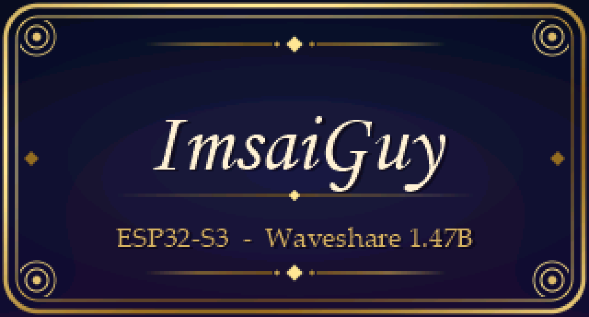
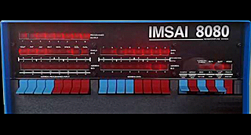
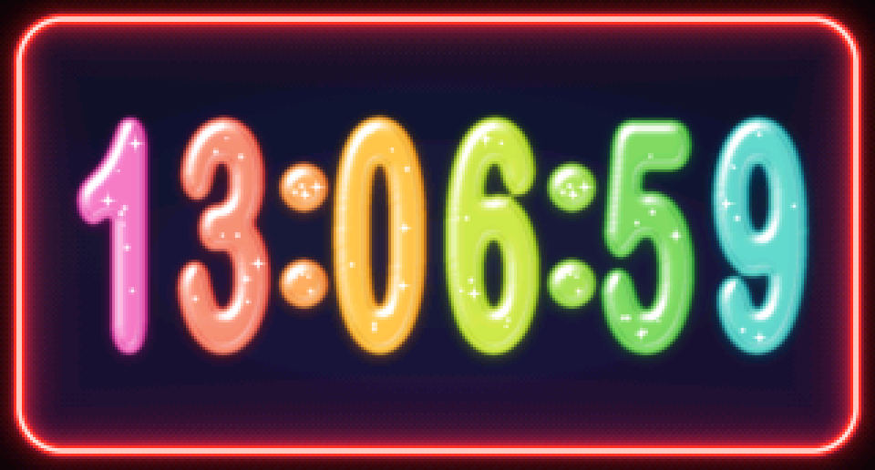

# IMSAI display + jelly clock

For the Waveshare ESP32-S3-LCD-1.47B (ST7789, 172 x 320, used as landscape 320 x 172).

Three screens, changed by pressing the **BOOT** button (GPIO 0, low while pressed, 10K pull-up on the board; RESET only
restarts the chip). After a reset it starts on the first screen. The on-board RGB LED (GPIO 38, WS2812B, byte order R,G,B)
shows which screen is up.

| # | Screen | LED |
|---|--------|-----|
| 1 | "ImsaiGuy" title scene with a gold frame | green |
| 2 | IMSAI 8080 front panel photo, its 44 LEDs animated from a recording of a real machine (30 fps, looping; it plays on in real time even while another screen is up) | red |
| 3 | Real-time clock H:MM:SS (12 hour, no AM/PM mark, blank instead of a leading zero): glossy "jelly" digits, a different colour per position, in a red neon tube frame | blue |

### 1. Title scene



*Read back from the board's frame buffer (3x enlarged).*

### 2. Front panel



*The photo as it is stored in the firmware (320 x 172, shown here without the animated LED glow, which only exists on the board).*

### 3. Clock



*Read back from the board's frame buffer (3x enlarged).*

## Time

The board has no battery-backed clock, so a power cut clears it. It gets the time from NTP over Wi-Fi (2.4 GHz only):

```
python tools\set_wifi.py COM9
```

Run it yourself: it asks for the network name and the hidden password, which the board keeps in its flash
(`--forget` clears them). After a power cut the clock starts at the firmware's build time and jumps to the right
time once Wi-Fi connects (it took about 30 s in a test).

The time zone (daylight saving included) is set from this PC:

```
powershell -ExecutionPolicy Bypass -File tools\flash.ps1 [-Port COM9] [-NoBuild]
```

This builds, flashes, and sets the zone and the time over USB serial straight away. `python tools\set_time.py COM9` does
only the last part (use the ESP-IDF Python: it has pyserial). Flashing the merged image below erases the saved Wi-Fi
settings: run `set_wifi.py` again.

Serial commands (115200, USB): `Z<tz>`, `T<epoch>`, `W<ssid><TAB><password>`, `I` (status), `D` (dump the screen).

## Ready-to-flash image

Any 1.47B board; replace COM9; hold BOOT while pressing RESET if it will not enter download mode:

```
python -m esptool --chip esp32s3 -p COM9 -b 460800 write_flash 0x0 firmware\imsai_clock_merged_0x0.bin
```

SHA-256 `E656356320DFA92D462A596906ED7A2EB5F9912096EF3188BA9C2DEE38FB0187`

Then run `python tools\set_wifi.py COM9` and `python tools\set_time.py COM9` (time zone).

## How it is built

- **Memory:** the finished title scene and the neon background are drawn once at start-up into the 8 MB octal PSRAM
  (`CONFIG_SPIRAM`, `sdkconfig.defaults`), so changing screen is a copy. The display buffer is in internal RAM.
- **No graphics library:** ESP-IDF v5.5.2 `esp_lcd` ST7789 driver only.
- **Source:** `main/main.c`. Generated data: `main/photo.h` (`tools/gen_image.ps1`), `main/fonts.h` (`tools/gen_fonts.ps1`),
  `main/leds.h` (`tools/extract_leds.py` + `led_sites.csv`, from a screen recording that is NOT in this repo),
  `main/jelly.h` (`tools/export_masks.ps1` writes `assets/masks.bin`, then `tools/gen_jelly.py 88 38`; needs numpy).
- `tools\grab_frame.py COM9 out.png` saves what is really on the screen as a PNG.
- Fonts are installed Windows fonts: check the licences before distributing firmware.

Build only: `idf.py set-target esp32s3` then `idf.py build`.
